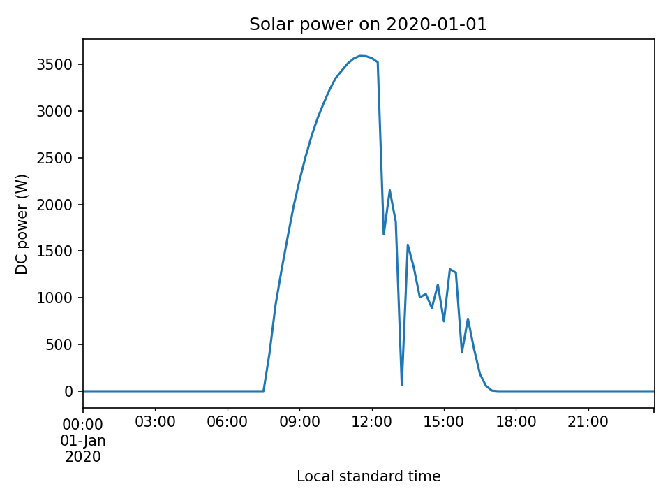

# SunnyPeak user guide

Use SunnyPeak to simulate a fixed solar array, find a tilt and direction for it, and export the results. The walkthrough uses one array and one weather year. When you run your own project, supply the latitude, longitude, and year for that run.

## Get started

Open a terminal in the extracted project folder. Install the dependencies with Python 3.10 or later.

```bash
python -m pip install -r requirements.txt
```

Run the Python examples below in order in the same script or notebook. The bundle includes the 2020 weather for latitude 34.73°, longitude 10.76°, and the catalog entry `PV-MJT250GB`. These examples work offline.

## Get weather data

SunnyPeak uses the National Solar Radiation Database (NSRDB) **Meteosat Prime Meridian, Physical Solar Model v4** dataset. Its footprint includes parts of Europe, Africa, and the Middle East. NLR lists calendar years **2005–2022** and **15-, 30-, and 60-minute** download intervals. NSRDB selects the nearest available grid point for the coordinates you request. Check your point's available years and intervals in the dataset entry named `nsrdb-msg-v1-0-0`. [Dataset and download API](https://developer.nlr.gov/docs/solar/nsrdb/nsrdb-msg-v1-0-0-download/) · [Coverage material](https://www.sandia.gov/app/uploads/sites/243/dlm_uploads/2024/05/PVPMC-2024-NSRDB-presentation-screen.pdf#page=19) · [NSRDB Data Query](https://developer.nlr.gov/docs/solar/nsrdb/nsrdb_data_query/)

| Weather field | Meaning |
| --- | --- |
| `DNI` (W/m²) | Direct sunlight reaching a surface facing the sun |
| `DHI` (W/m²) | Diffuse sky radiation reaching a horizontal surface |
| `Temperature` (°C) | Air temperature |
| `Wind Speed` (m/s) | Wind speed used in estimating panel temperature |

Enter coordinates in decimal degrees, with negative values for south and west. A simulation runs from January through December in local standard time. February 29 is omitted. `weather_interval_minutes` selects the source weather spacing, and `time_step_minutes` sets the spacing of the simulation results. Both default to 15 minutes. When they differ, SunnyPeak interpolates the weather onto the simulation grid.

### Get a key for new downloads

Request an API key with an active email address. Follow the verification instructions, then set `NSRDB_API_KEY` and `NSRDB_EMAIL` in the terminal where you will run Python. Replace the placeholders with your own values and keep the key private. [NLR API key signup](https://developer.nlr.gov/signup/) · [NLR API key usage](https://developer.nlr.gov/docs/api-key/)

In Bash or Zsh, use these commands.

```bash
export NSRDB_API_KEY="YOUR_NLR_API_KEY"
export NSRDB_EMAIL="your-email@example.com"
```

In PowerShell, use these commands.

```powershell
$env:NSRDB_API_KEY = "YOUR_NLR_API_KEY"
$env:NSRDB_EMAIL = "your-email@example.com"
```

SunnyPeak looks for a weather CSV matching the requested coordinates, year, and source interval. It looks under `data/weather`, where the folder name puts longitude first. For the walkthrough, SunnyPeak reads this file.

```text
data/weather/POINT(10.76 34.73)/year_2020_interval_15.csv
```

On a cache miss, SunnyPeak sends one HTTPS request to the Meteosat CSV endpoint for that point, year, and interval. It requests the four weather fields above in local standard time, with leap day omitted. It saves the returned CSV to that path and reuses it on later runs. To use your own site, change the latitude, longitude, and year in the simulation call below. [CSV request parameters](https://developer.nlr.gov/docs/solar/nsrdb/nsrdb-msg-v1-0-0-download/)

## Simulate an array

Enter your panel specifications, panel count, and the angles you plan to install. This example uses twelve 420 W panels on a 20° roof facing southeast. Tilt is measured from horizontal. Azimuth is the compass direction clockwise from north, so southeast is 135°.

```python
from sunnypeak import simulate_solar

site = {"latitude": 34.73, "longitude": 10.76, "year": 2020}
panel = {
    "rated_power_w": 420,
    "temperature_coefficient_pct_per_c": -0.35,
    "efficiency": 0.21,
    "nominal_cell_temperature_c": 45,
}
panel_count = 12

result = simulate_solar(
    **site,
    panel_spec=panel,
    panel_count=panel_count,
    tilt_deg=20,
    azimuth_deg=135,
)
print(f"{result['annual_kwh']:,.0f} kWh for the year")
```

The example returns **9,587 kWh** of modeled DC energy for the year. That is the array's output before inverter and other system losses.

To use the catalog panel, pass `panel_name="PV-MJT250GB"` in place of `panel_spec=panel`. The catalog is in `data/panels.csv`.

To save a new panel in the catalog, run this once in an interactive Python session. For the example module, enter `420`, `-0.35`, `0.21`, and `45` at the prompts. The temperature coefficient is in percent per °C, and the efficiency is a fraction, so `0.21` means 21%.

```python
from pv_panel import add_panel

add_panel("Example 420 W")
```

After saving it, pass `panel_name="Example 420 W"` in place of `panel_spec=panel` when running the simulation.

## Optimize tilt and direction

Use the same site, weather year, and panels. Leave out the tilt and azimuth so SunnyPeak can search for a fixed orientation that maximizes the modeled DC energy.

```python
optimized = simulate_solar(
    **site,
    panel_spec=panel,
    panel_count=panel_count,
    optimize_for="power",
)
print(f"Tilt {optimized['tilt_deg']:.1f}°, azimuth {optimized['azimuth_deg']:.1f}°")
print(f"{optimized['annual_kwh']:,.0f} kWh for the year")
```

For the example, SunnyPeak finds **27.7° tilt** and **177.7° azimuth**, with **9,976 kWh** of modeled DC energy. Use `optimize_for="irradiance"` to maximize sunlight on the panel surface. The corresponding total is `annual_irradiation_kwh_m2`.

## Export and plot a simulation result

The fixed simulation and the optimized run both return a dictionary. The examples below use `result` from the fixed simulation. Use `optimized` to export the optimized run.

### Get the data as a CSV

```python
result["timeseries"].to_csv("simulation.csv", index_label="timestamp")
```

The CSV has one row per simulation step. At the default 15-minute step, there are 35,040 rows for the year. For example, 1,200 W over one 15-minute interval corresponds to 0.30 kWh.

| Column | Meaning |
| --- | --- |
| `timestamp` | Interval start in local standard time, with its UTC offset |
| `power_w` | Modeled DC power from the array in watts |
| `irradiance_w_m2` | Sunlight intensity on the panel surface in W/m² |
| `cell_temperature_c` | Estimated solar cell temperature in °C |
| `energy_kwh` | Modeled DC energy produced by the array during the interval |
| `irradiation_kwh_m2` | Sunlight energy received per square metre of panel surface during the interval |

### Plot one day from the CSV

Read the exported file and select its first date. The result is a line plot of the array's power over that day.

```python
import pandas as pd
import matplotlib.pyplot as plt

data = pd.read_csv("simulation.csv", parse_dates=["timestamp"], index_col="timestamp")
day = data.index[0].strftime("%Y-%m-%d")

ax = data.loc[day, "power_w"].plot(
    title=f"Solar power on {day}",
    xlabel="Local standard time",
    ylabel="DC power (W)",
)
ax.figure.tight_layout()
plt.show()
```

Change `day` to any date in the CSV. To save the chart, add `ax.figure.savefig("solar-power.png", dpi=150)` before `plt.show()`.



## Core reference

### Simulation options and results

`simulate_solar(latitude, longitude, year, ...)` returns a dictionary. Pass the three required inputs by position or by name. The remaining inputs are keyword arguments.

| Input | Accepted values |
| --- | --- |
| `panel_name`, `panel_spec`, `panel_count` | Select a catalog model or supply a dictionary with the four datasheet values shown above. With both panel options omitted, the catalog model is `PV-MJT250GB`. Panel count is a positive integer and defaults to one. |
| `tilt_deg`, `azimuth_deg`, `optimize_for` | Pass both angles for a fixed layout. Tilt spans 0° to 90° from horizontal. Azimuth wraps at 360°. When both angles are omitted, the objective defaults to `"power"`. |
| `time_step_minutes`, `weather_interval_minutes` | The simulation step must divide 1,440 minutes evenly. The source weather interval is 15, 30, or 60 minutes. |
| `standoff_inches`, `building_stories` | Mounting clearance and building height used by the temperature model. They default to two inches and two stories. |

`result["annual_kwh"]` is total DC energy and `result["annual_irradiation_kwh_m2"]` is incident sunlight energy per square metre. The `daily` and `monthly` tables give period energy totals and mean power and irradiance. The `timeseries` table has the fields in the CSV table above. The `tilt_deg`, `azimuth_deg`, and `optimized_for` keys record the orientation and objective. A fixed-angle result has `result["optimized_for"] is None`.

### Model helpers

At this level, `time_step` and `delta_T` are the simulation and weather intervals in minutes. The model takes tilt in radians from horizontal and azimuth in radians westward from north. Convert the public clockwise azimuth with `gamma = -radians(azimuth_deg)`.

| Module and functions | Inputs and outputs |
| --- | --- |
| `weather.get_weather`, `weather.interpolate_data`, `weather.download_nsrdb_data` | Load requested weather arrays and the UTC offset, resample a 365-day weather series, or fetch a single CSV into the cache. |
| `solar.get_solar_angles`, `solar.solar_angles` | Calculate angles for the full year or for given minutes from January 1. Both return cosine and sine of altitude, then sine and cosine of azimuth. |
| `irradiation.get_irradiation`, `irradiation.calculate_irradiation` | Return irradiance in W/m² after loading weather or from prepared sun angles and irradiance inputs. |
| `Power.get_power`, `Power.calculate_power`, `Power.get_cell_temperature`, `Power.power_from_irradiance` | Compute DC watts from a site or prepared arrays, estimate cell temperature in °C, or convert irradiance and temperature arrays to watts. |
| `optimize.optimize_yearly_irradiation`, `optimize.optimize_yearly_power`, `optimize.optimize_orientation` | Return the chosen angles in radians and annual mean output from the irradiance model, power model, or a supplied model. |
| `optimize.negative_yearly_irradiation_sum`, `optimize.negative_yearly_power_sum` | Return negated sample sums for a minimizer. Convert each power sample from watts to kWh with `time_step / 60_000` before summing for energy. |
| `tools.average_over_period`, `tools.monthly_averages`, `tools.get_values_for_period` | Average full blocks of days, return 12 calendar-month means, or slice a 365-day series by `dd/mm` dates. The slice excludes the end date. |
| `sunnypeak._summarize` | Aggregate timestamped results. It sums interval energy and averages power and irradiance. |
| `pv_panel.get_panel`, `pv_panel.add_panel`, `pv_panel.resolve_panel` | Read or add a catalog model, or load the four datasheet values from a catalog name or dictionary. |
| `plots.plot_solar(result)` | Return a Matplotlib figure with daily and monthly energy and example power profiles. |

The low-level irradiance and power models take cosine before sine for solar azimuth. `negative_yearly_power_sum` takes sine before cosine. For direct power calculations, the wrapper uses rated watts divided by 1,000 for `P_i`, the percentage temperature coefficient divided by 100 for `gamma_c`, and efficiency divided by 0.9 for the optical efficiency.
